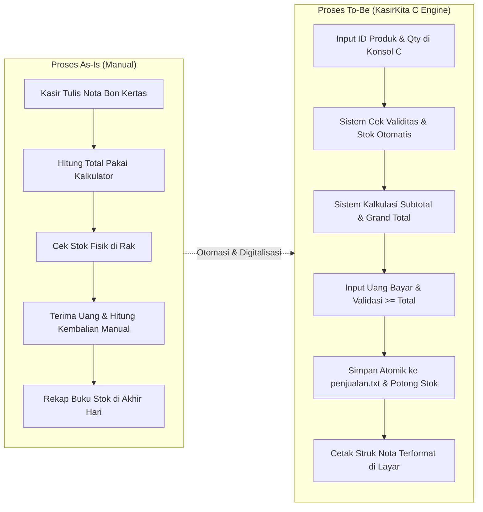
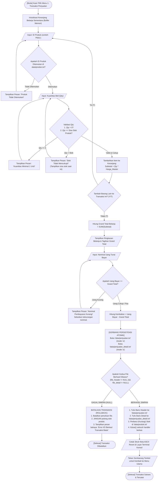
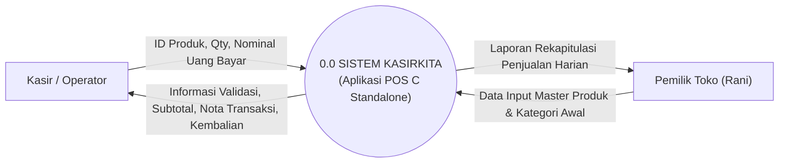
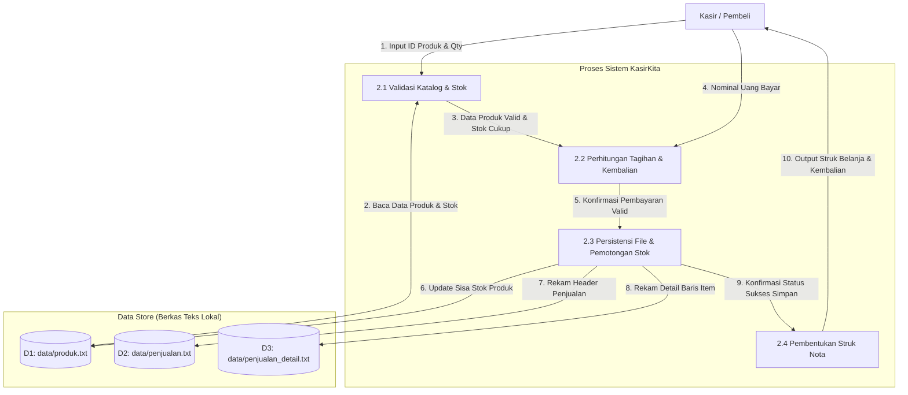

# DOKUMEN SPESIFIKASI PROSES BISNIS (PROBIS)
**Modul Proyek:** Modul 01 — Dokumen Persiapan & Rekayasa Probis  
**Kode Probis:** `PROBIS-POS-01`  
**Nama Fitur:** Transaksi Penjualan Kasir & Checkout (*Point of Sales*)  
**Aplikasi Acuan:** KasirKita — Aplikasi Kasir C Standalone Windows  
**Status Berkas:** *Dokumen Before Sidang (Wajib Disusun untuk Sidang Proposal & Acuan Uji)*

---

## 1. Overview & Problem Framing

### 1.1 Latar Belakang & Identifikasi Masalah
Toko Kelontong Rani saat ini mengelola operasional harian secara konvensional (manual). Setiap kali terjadi transaksi penjualan:
1. Kasir mencatat nama barang, kuantitas, dan estimasi harga di nota bon kertas berkarbon.
2. Penjumlahan subtotal, grand total belanja, dan perhitungan uang kembalian dilakukan menggunakan kalkulator meja secara manual.
3. Rekapitulasi barang yang terjual dan pemotongan stok dilakukan di buku stok fisik pada sore hari setelah toko tutup.

Kelemahan dan risiko (*pain points*) dari alur manual ini:
- **Human Error dalam Kalkulasi:** Sering terjadi kesalahan hitung kembalian dan total belanja, terutama saat antrean pelanggan ramai.
- **Korupsi Data Stok:** Kasir tidak dapat mengetahui secara pasti apakah stok produk di gudang masih ada tanpa mengecek rak secara fisik.
- **Risiko Manipulasi & Kehilangan Nota:** Nota kertas mudah tercecer, robek, basah, atau dimanipulasi nominalnya sebelum diserahkan kepada pemilik toko.
- **Waktu Rekapitulasi Lambat:** Pemilik toko membutuhkan waktu 1–2 jam per hari hanya untuk mencocokkan uang fisik di laci kas dengan catatan bon.

### 1.2 Solusi Sistem Terkomputerisasi (*KasirKita*)
Aplikasi *KasirKita* dikembangkan sebagai sistem kasir mandiri (*standalone*) berbasis bahasa C pada konsol Windows untuk mengotomasikan alur transaksi penjualan secara real-time, akurat, dan terstruktur dengan persistensi berkas teks lokal (*Flat-File System*).

### 1.3 Batasan Lingkup (*Scope Management*)
Untuk mencegah terjadinya pembengkakan fitur (*scope creep*) saat sidang, batasan sistem dikunci secara tegas:
- **In-Scope (Dikerjakan):**
  - Pemilihan produk melalui input ID Produk alfanumerik (misal: `"P001"`).
  - Pengecekan otomatis stok sebelum transaksi disetujui.
  - Perhitungan otomatis subtotal, grand total, dan uang kembalian.
  - Validasi nominal uang bayar tidak boleh kurang dari total belanja.
  - Penyimpanan riwayat transaksi secara atomik ke berkas teks lokal `data/penjualan.txt`.
  - Pemotongan stok otomatis pada berkas teks master `data/produk.txt`.
  - Pencetakan struk nota transaksi terformat pada konsol Windows menggunakan pustaka `lib.h`.
- **Out-of-Scope (Bukan Tanggung Jawab Proyek):**
  - Pembayaran online / integrasi Payment Gateway QRIS / Mesin EDC Kartu Debit.
  - Sinkronisasi awan (*Cloud / Web API / Multi-branch Database*).
  - Sistem multi-kasir konkuren berbasis jaringan LAN.
  - Integrasi printer thermal hardware driver (struk dicetak virtual di layar konsol terminal).

---

## 2. Klasifikasi Data Master vs Data Transaksi

Dalam rekayasa perangkat lunak sistem kasir, memisahkan secara tegas antara **Data Master** dan **Data Transaksi** adalah fondasi mutlak agar penguji sidang tidak menemukan celah anomali data (*data anomaly*).

```
+------------------------------------------------------------------------+
|                          ARSITEKTUR DATA KASIRKITA                     |
+------------------------------------------------------------------------+
|  DATA MASTER (Statis / Referensi)   |  DATA TRANSAKSI (Dinamis / Kejadian) |
|  - Relasi Entitas Awal              |  - Rekaman Riwayat Kejadian Nyata   |
|  - Dirujuk oleh Transaksi           |  - Snapshot Nilai pada Waktu Transaksi|
|  - Contoh: Kategori, Produk, Member |  - Contoh: Penjualan, Detail Item   |
+-------------------------------------+----------------------------------+
```

### 2.1 Entitas Data Master
Data master adalah data referensi inti yang keberadaannya bersifat permanen atau jarang berubah.

1. **Master Kategori (`data/kategori.txt`):**
   - Mengelompokkan jenis produk toko.
   - Atribut:
     - `id_kategori` : String[10] — *Primary Key* (contoh: `"KAT01"`, `"KAT02"`)
     - `nama_kategori` : String[50] (contoh: `"Alat Tulis"`, `"Sembako"`, `"Minuman"`)

2. **Master Produk (`data/produk.txt`):**
   - Menyimpan informasi katalog barang dagangan yang dijual.
   - Atribut:
     - `id_produk` : String[10] — *Primary Key* (contoh: `"P001"`, `"P002"`)
     - `nama_produk` : String[50] (contoh: `"Buku Tulis Sinar Dunia A5"`)
     - `id_kategori` : String[10] — *Foreign Key* ke Master Kategori
     - `harga_jual` : Integer (satuan rupiah, contoh: `12000`)
     - `stok` : Integer (kuantitas sisa fisik, contoh: `20`)
     - `satuan` : String[10] (contoh: `"PCS"`, `"BOX"`, `"PAK"`)

3. **Master Pelanggan / Member (`data/pelanggan.txt` - Opsional):**
   - Menyimpan identitas pelanggan terdaftar untuk program loyalitas toko.
   - Atribut:
     - `id_pelanggan` : String[10] — *Primary Key* (contoh: `"MBR001"`, `"GUEST"`)
     - `nama_pelanggan` : String[50] (contoh: `"Rani Safitri"`)
     - `no_telepon` : String[20]
     - `poin_loyalitas` : Integer

---

### 2.2 Entitas Data Transaksi
Data transaksi adalah data rekaman peristiwa yang tercipta saat kasir memproses pembelian pelanggan. Data ini bertambah terus-menerus seiring berjalannya toko dan pantang diubah (*immutable*).

1. **Header Penjualan (`data/penjualan.txt`):**
   - Mencatat metadata umum satu kali struk pembayaran.
   - Atribut:
     - `id_penjualan` : String[20] — *Primary Key* (Format Unik: `"TRX-YYYYMMDD-XXXX"`, misal `"TRX-20261109-0001"`)
     - `tanggal_waktu` : String[20] (Format ISO: `"2026-11-09 14:30:00"`)
     - `id_pelanggan` : String[10] — *Foreign Key* ke Master Pelanggan (default: `"GUEST"`)
     - `total_item` : Integer (jumlah variasi barang yang dibeli)
     - `grand_total` : Integer (total nominal yang wajib dibayar)
     - `uang_bayar` : Integer (uang fisik yang diserahkan pelanggan)
     - `uang_kembali` : Integer (`uang_bayar - grand_total`)
     - `id_kasir` : String[20] (identitas kasir yang bertugas)

2. **Detail Penjualan (`data/penjualan_detail.txt`):**
   - Mencatat rincian barang per baris dalam satu nomor struk penjualan.
   - Atribut:
     - `id_detail` : String[20] — *Primary Key* (contoh: `"DET-0001"`)
     - `id_penjualan` : String[20] — *Foreign Key* ke Header Penjualan
     - `id_produk` : String[10] — *Foreign Key* ke Master Produk
     - `harga_saat_transaksi` : Integer — **Snapshot Harga Historis**
     - `qty_beli` : Integer (kuantitas unit yang dibeli, $\ge 1$)
     - `subtotal` : Integer (`harga_saat_transaksi * qty_beli`)

---

### 2.3 Kaidah Integritas Harga Historis (*Price Snapshot Principle*)
> [!IMPORTANT]
> **Kaidah Emas Sidang RPL:** Dilarang menghitung omzet penjualan masa lalu dengan cara mengalikan `qty_beli` di transaksi dengan `harga_jual` di Master Produk!  
> **Alasan Akademik:** Jika bulan depan harga master Buku Tulis dinaikkan dari Rp12.000 menjadi Rp15.000, maka omzet laporan keuangan bulan lalu akan otomatis melonjak palsu jika sistem tidak menyimpan **Snapshot Harga Historis** (`harga_saat_transaksi`) pada saat struk dibuat.

---

### 2.4 Contoh Representasi Berkas Teks (*Flat-File Layout*)

**Berkas Master: `data/produk.txt` (Pemisah Pipe `|`)**
```text
P001|Buku Tulis Sinar Dunia A5|KAT01|12000|18|PCS
P002|Pulpen Pilot Ballpoint Hitam|KAT01|3500|45|PCS
P003|Beras Ramos 5kg|KAT02|68000|10|KARUNG
```

**Berkas Transaksi: `data/penjualan.txt`**
```text
TRX-20261109-0001|2026-11-09 14:30:00|GUEST|1|24000|30000|6000|KASIR01
```

**Berkas Transaksi: `data/penjualan_detail.txt`**
```text
DET-0001|TRX-20261109-0001|P001|12000|2|24000
```

---

## 3. Komparasi Proses Bisnis: *As-Is* vs *To-Be*



---

## 4. Diagram Alir Probis (Flowchart Atomik Standar Sidang)

Diagram ini mengilustrasikan alur transaksi penjualan secara lengkap, mencakup **jalur sukses (*Happy Path*)**, **jalur pencegahan kesalahan input (*Boundary / Negative Path*)**, dan **jalur mitigasi kegagalan penyimpanan I/O (*Failure Rollback Path*)**:



---

## 5. Diagram Aliran Data (DFD)

### 5.1 DFD Level 0 (Context Diagram)
Menggambarkan batasan sistem *KasirKita* terhadap entitas lingkungan luar:



### 5.2 DFD Level 1 (Fokus Proses Penjualan & Persistensi Berkas)



---

## 6. Matriks Spesifikasi IPO (Input - Process - Output)

| No | Tahap Aktivitas | Masukan Data (*Input*) | Logika & Pemrosesan (*Process*) | Keluaran Data (*Output*) | Target Penyimpanan |
| :---: | :--- | :--- | :--- | :--- | :--- |
| **1** | Seleksi Barang | `id_produk` (String), `qty` (Int) | Cari kecocokan di `data/produk.txt`. Bandingkan $qty \le stok$. | Nama barang, harga satuan, status ketersediaan stok. | Memori internal (*Buffer Cart Struct*) |
| **2** | Perhitungan Subtotal | `qty`, `harga_jual` | `subtotal = qty * harga_jual` | Nilai subtotal per baris item. | Memori internal (*Buffer Cart Struct*) |
| **3** | Kalkulasi Tagihan | Kumpulan `subtotal` | `grand_total = SUM(subtotal)` | Nominal grand total belanja. | Layar konsol (*HUD Total*) |
| **4** | Validasi Pembayaran | `uang_bayar` (Int) | Periksa $uang\_bayar \ge grand\_total$. Hitung $kembali = uang\_bayar - grand\_total$. | Status pembayaran lunas & nilai uang kembalian. | Layar konsol |
| **5** | Persistensi Transaksi | Data header & array item | Buka file teks mode `"a"`. Tulis format delimited. Jika `fopen == NULL`, batalkan. | Status operasi I/O (Sukses/Gagal). | `data/penjualan.txt` & `data/penjualan_detail.txt` |
| **6** | Pemotongan Stok | `id_produk`, `qty_beli` | Cari record produk di `data/produk.txt`. `stok_baru = stok_lama - qty_beli`. Tulis ulang file. | Berkas master terbarui. | `data/produk.txt` |
| **7** | Cetak Struk | Data transaksi lengkap | Gambar kotak garis ganda `borderDoubleLine()` dari `lib.h`, cetak detail item dan footer kembalian. | Tampilan nota ASCII di layar terminal. | Layar konsol Windows |

---

## 7. Aturan Bisnis Kunci (*Business Rules*) & Skenario Acuan Uji

### 7.1 Empat Aturan Bisnis Wajib (*Core Business Invariants*)
1. **Rule 1 — Non-Negative Quantity Rule:**  
   Nilai $qty$ wajib bilangan bulat positif $> 0$. Input berupa nilai negatif ($-2$), nol ($0$), atau non-angka (`"dua"`) wajib dicegah pada *layer* input konsol.
2. **Rule 2 — Exact/Surplus Cash Rule:**  
   Pelanggan tidak dapat menyelesaikan checkout jika $uang\_bayar < grand\_total$. Sistem tidak mengizinkan transaksi hutang (*piutang*).
3. **Rule 3 — Atomic Persistence Gatekeeper:**  
   **Dilarang keras mencetak nota belanja sebelum proses penulisan kedua berkas teks (`penjualan.txt` dan `penjualan_detail.txt`) sukses 100%.** Jika berkas gagal dibuka, batalkan transaksi dan jangan potong stok.
4. **Rule 4 — Immutable Historic Ledger Rule:**  
   Harga produk pada detail transaksi mengunci harga pada detik transaksi terjadi. Perubahan harga jual di master barang di masa depan tidak mempengaruhi nilai transaksi historis.

---

### 7.2 Skenario Acuan Uji Sidang (Kasus Riil Rani)
Gunakan tabel skenario ini sebagai pembuktian konkret saat dosen penguji meminta demonstrasi:

| Parameter Uji | Data Masukan Uji (*Test Input*) | Ekspektasi Logika (*Expected Result*) | Bukti Lapangan (*Actual Check*) |
| :--- | :--- | :--- | :--- |
| **Kondisi Awal** | Master Produk: `"P001"` (Buku Tulis A5)<br>Harga: $\text{Rp}12.000$, Stok Awal: $20$ | Sistem mengenali produk terdaftar dan stok siap jual. | Terbaca di `data/produk.txt` |
| **Uji Normal (*Happy Path*)** | Kasir input: `P001`, Qty = $2$<br>Uang bayar = $\text{Rp}30.000$ | Subtotal = $\text{Rp}24.000$<br>Grand Total = $\text{Rp}24.000$<br>Kembalian = $\text{Rp}6.000$<br>Sisa Stok = $18$ unit | Struk nota tercetak rapi, berkas `penjualan.txt` bertambah 1 baris. |
| **Uji Serangan (*Negative Qty*)** | Kasir input: `P001`, Qty = $-5$ | Sistem menolak input, menampilkan pesan error, stok tetap $20$. | Transaksi tidak tersimpan di berkas. |
| **Uji Uang Kurang (*Underpaid*)** | Total tagihan = $\text{Rp}24.000$<br>Uang bayar = $\text{Rp}20.000$ | Sistem menolak checkout, menampilkan pesan `"Uang Kurang Rp4.000"`. | Transaksi belum boleh dicatat ke file. |
| **Uji Kegagalan I/O (*Disk Crash*)** | Simulasi folder `data/` dikunci *Read-Only* | `fopen()` menghasilkan `NULL`. Program membatalkan transaksi dan stok tetap $20$ (Rollback). | Terminal tidak mengalami *crash / segmentation fault*. |
